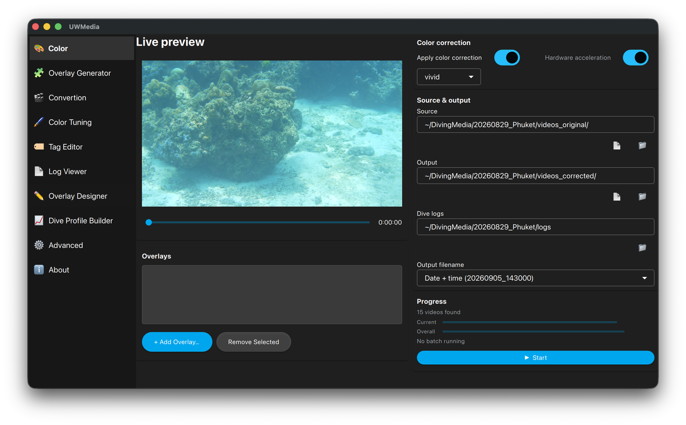

# Color

Batch colour correction for a file or a whole folder of photos and videos,
with optional telemetry overlays burned in.

  

## Using it

1. **Source & output** - pick the source (a file or a folder) and the output
   folder. Point **Dive logs** at the folder with your logs if you want
   overlays.
2. **Color correction** - tick *Apply color correction* and pick a profile
   (`default`, `vivid`, `subtle`, or one you made in
   [Color Tuning](color-tuning.md)).
3. **Overlays** (optional) - **+ Add Overlay…** picks a template (brand →
   dive computer → page). Drag the overlay into place on the **Live preview**.
   You can add several; **Remove Selected** takes one off again. Each file is
   matched to its dive by the time it was taken.
4. **Output filename** - **Original** keeps the name (only the extension is
   made lower-case, e.g. `DSC06641.JPG` → `DSC06641.jpg`), **Original +
   color** adds `_color` to it (`DSC06641_color.jpg`), or name files by the
   date + time taken (`20260905_143000`) or date + time + `_color`.
5. **Clock offset**, under the preview - if the overlay runs ahead of or
   behind the footage, the camera's clock is off against the dive
   computer's. Scrub to a frame where the computer is readable, type the
   dive time it shows into **Computer shows** (`12:34`) and press **Set**:
   that frame becomes that moment of the dive. Without the computer in view,
   nudge with the **-1m … +1m** buttons until the overlay's depth follows the
   scene; **0** clears it. **Hours** is for a camera left on home time. The
   preview follows every change, and every file in the run is matched with
   the offset (the files' own times are written to the output unchanged).
   The offset is remembered, so the next run from the same camera starts
   from it.
6. **Hardware acceleration** uses the GPU encoder where available.
7. Press **▶ Start** (it becomes **■ Abort** while running). Progress is
   shown for the current file and overall, with the time spent and, once a
   few percent are done, an estimate of the time left. The line stays after
   the run ("Finished in 13:41").

Only one batch job (Color, Overlay Generator or Convertion) can run at a time.

## Good to know

- Video colour correction runs as a 3D LUT inside FFmpeg, which is much
  faster than processing frame by frame - see [How it works](technical.md).
- The original camera metadata (QuickTime, DJI, Sony …) is copied to the
  output, and the date taken is kept.
- Overlays are drawn at the footage's own resolution and are left out of the
  colour correction: the correction is applied to the video underneath, so a
  dive computer's bezel and text keep the colours you see in the
  [Overlay Designer](overlay-designer.md) instead of picking up the underwater
  red boost.
- If you'd rather keep overlays as a separate layer in your editor, use the
  [Overlay Generator](overlay-generator.md) instead of burning them in here.
- CLI equivalent: `python cli_main.py SRC OUT --color [profile] [--logs DIR --layout …]`
  - see [CLI](cli.md).
